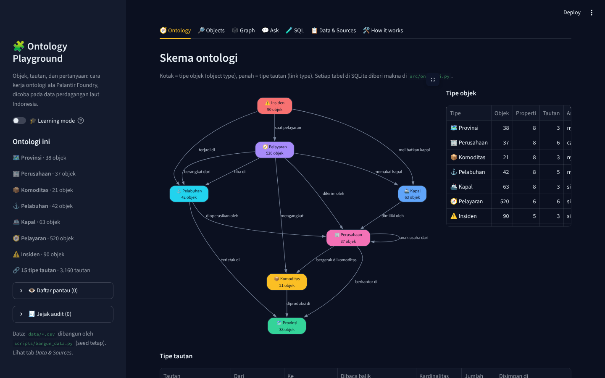
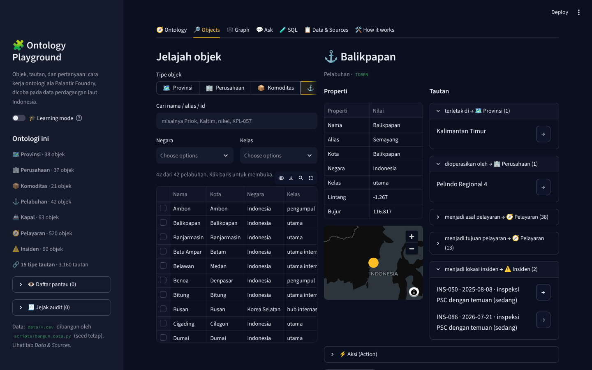
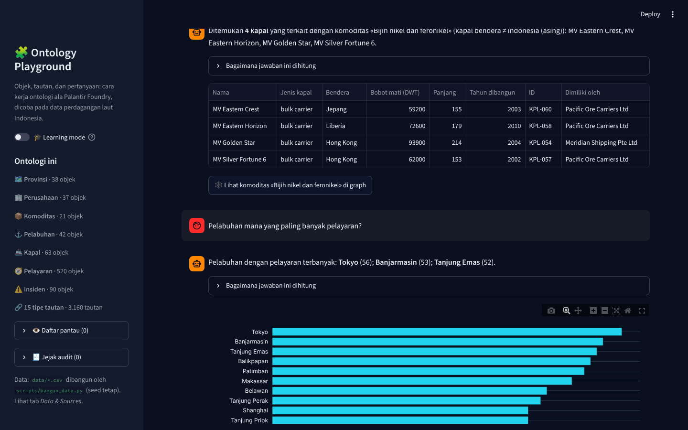
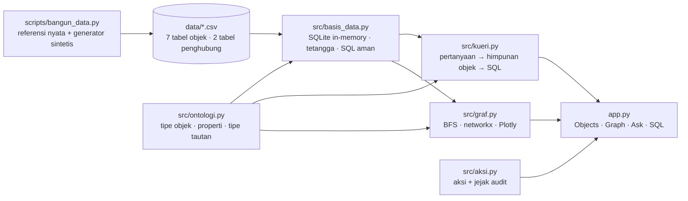

# 🧩 Ontology Playground

[](https://github.com/Avalon2222/ontology-playground/actions/workflows/tests.yml)


> Demo konsep **ontology** ala Palantir Foundry pada data perdagangan laut Indonesia: pelabuhan, kapal, komoditas,
> perusahaan, provinsi, pelayaran, dan insiden saling terhubung lewat tautan bernama, bisa dijelajahi sebagai objek,
> digambar sebagai graf, dan **ditanyai dengan bahasa sehari-hari tanpa model bahasa**: pertanyaan diubah menjadi
> himpunan objek lalu SQL oleh mesin yang dipandu skema ontologi. Dibangun dengan Python, SQLite, networkx, Plotly, dan Streamlit.

## 🇬🇧 In English

**Connect everything. Then ask it anything.** A hands-on demo of what a Palantir Foundry-style *ontology* actually is, built on Indonesian maritime trade data: seven object types (Province, Port, Commodity, Company, Vessel, Voyage, Incident) linked by fifteen named link types, browsable as objects, drawable as a graph, and queryable in plain Indonesian. The question engine uses no language model: it recognises the objects you mention, finds the shortest path between object types in the schema, and writes the SQL for you, showing every step.

- **Browse** any object with its properties and every linked object, and pivot from one to the next like a Foundry object view.
- **Explore** the neighbourhood of a vessel, a company, or a port as an interactive graph, two or three hops deep.
- **Ask** questions such as *which foreign-flagged vessels carried nickel* or *busiest port in 2025* and read the generated object-set plan and SQL.
- **Act** on objects with Foundry-style actions (flag a vessel for inspection, close an incident) that land in an audit trail.

**Built with:** Python, SQLite, pandas, networkx, Plotly, Graphviz, Streamlit  
**Data:** Real provinces, ports, commodities, producing regions and port operators; synthetic companies, vessels, voyages and incidents generated by a seeded script  
**Engineering:** One schema module drives every feature; 79 pytest tests with CI on GitHub Actions

*The rest of this README is in Indonesian.*

**🚀 Coba langsung di browser:** [ontology-playground.streamlit.app](https://ontology-playground.streamlit.app)



> ℹ️ **Disclaimer.** Provinsi, pelabuhan, komoditas, provinsi penghasil, dan operator pelabuhan adalah data publik yang nyata.
> Perusahaan swasta, kapal, pelayaran, dan insiden **disintesis** oleh `scripts/bangun_data.py` dengan pola yang realistis dan
> tidak menggambarkan entitas yang sungguh ada. Proyek ini demo konsep untuk belajar dan portofolio pribadi, bukan sistem
> operasional, dan tidak berafiliasi dengan Palantir atau instansi mana pun.

## Latar belakang

Palantir menjual satu ide besar yang jarang dijelaskan dengan konkret: **ontology**. Bukan tabel, bukan dashboard,
melainkan lapisan yang memberi *makna* pada data: tabel `kapal` menjadi objek Kapal, kolom `pemilik_id` menjadi tautan
"dimiliki oleh" ke objek Perusahaan, dan setiap fitur di atasnya (penjelajah objek, graf, pencarian, aksi) cukup membaca
lapisan itu tanpa perlu tahu nama tabel.

Cara terbaik memahami ide seperti ini adalah membangunnya sendiri dalam skala kecil. Proyek ini mengambil domain yang
mudah dibayangkan, perdagangan laut Indonesia, menyusun tujuh tipe objek dan lima belas tipe tautan, lalu membangun
empat kemampuan khas Foundry di atasnya: **object view**, **graph explorer**, **object set / search around** (dibungkus
sebagai tanya-jawab), dan **action dengan jejak audit**. Bagian paling menarik adalah mesin tanya-jawabnya: tanpa model
bahasa, cukup skema ontologi dan BFS, pertanyaan seperti *"kapal berbendera asing mana yang mengangkut nikel"* sudah bisa
diterjemahkan menjadi SQL yang benar dan bisa dibaca.

## Fitur

| Tab | Isi |
|---|---|
| 🧭 Ontology | Diagram skema (Graphviz) dari definisi di `src/ontologi.py`, tabel tipe objek dan tipe tautan beserta kardinalitas, kolom penyimpan, dan jumlah objeknya |
| 🔎 Objects | Pilih tipe, cari nama/alias/id, filter kategori, klik baris untuk membuka **object view**: properti, peta kecil, semua tautan per tipe, tombol pivot →, riwayat navigasi, dan **aksi** |
| 🕸️ Graph | Subgraf BFS dari objek akar sampai 3 lompatan, pilih tipe tautan yang diikuti, klik simpul untuk membuka atau menjadikannya akar baru |
| 💬 Ask | Tanya dalam bahasa sehari-hari; jawaban berupa kalimat, tabel, grafik, dan expander *"Bagaimana jawaban ini dihitung"* berisi himpunan objek, pivot, filter, dan SQL-nya; mengenali rujukan seperti *"perusahaan itu"* |
| 🧪 SQL | Konsol SQL read-only ke SQLite yang sama, lengkap dengan skema dan contoh |
| 📋 Data & Sources | Asal setiap data, mana yang nyata dan mana yang sintetis, cek integritas referensi, tombol unduh |
| 🛠️ How it works | Diagram alur modul dan tabel padanan istilah Foundry ↔ kode di repo ini |
| 🎓 Learning mode | Toggle di sidebar: setiap tab menampilkan penjelasan konsep dan potongan kode |




## Cara menjalankan

```bash
git clone https://github.com/Avalon2222/ontology-playground.git
cd ontology-playground
python -m venv .venv && source .venv/bin/activate   # Windows: .venv\Scripts\activate
pip install -r requirements.txt
streamlit run app.py
```

Buka `http://localhost:8501`. Tidak perlu internet atau API key. Jalankan pengujian dengan `python -m pytest tests/ -v`
(79 tes). Untuk membangun ulang data: `python scripts/bangun_data.py` (hasilnya identik selama seed sama; `--seed 7`
untuk dunia yang berbeda).

## Cara kerja (ringkas)



**Ontologi.** Setiap `TipeObjek` menunjuk satu tabel dan mendaftarkan propertinya. Setiap `TipeTautan` menyebutkan tipe
sumber, tipe tujuan, label dua arah, dan *tabel/kolom mana yang menyimpannya*: untuk relasi N:1 itu kolom penunjuk di
tabel sumber (`kapal.pemilik_id`), untuk N:N itu tabel penghubung (`komoditas_provinsi`). Karena polanya seragam, satu
fungsi `tetangga()` bisa mengambil semua objek terkait untuk tipe apa pun.

**Mesin tanya-jawab** (`src/kueri.py`) bekerja dalam lima langkah deterministik:

1. **Entitas**: cocokkan nama, alias, dan id objek dari basis data ("Balikpapan", "Kaltim", "batu bara", "KPL-057"); teks terpanjang menang.
2. **Tipe target**: kata benda tipe objek yang ditanyakan ("kapal apa", "berapa pelayaran"); kata tipe yang menempel pada entitas bertipe sama ("pelabuhan Balikpapan") hanya penjelas.
3. **Maksud**: daftar, hitung (*berapa*), peringkat (*terbanyak*, *tersibuk*), urut properti (*terbesar*, *tertua*), atau detail.
4. **Jalur**: BFS pada graf skema dari tipe target ke tipe setiap entitas. Bila dua tipe dihubungkan lebih dari satu tautan (pelayaran *berangkat dari* / *tiba di* pelabuhan), kata tepat sebelum entitas ("dari", "ke") yang memilih.
5. **SQL**: `SELECT DISTINCT target JOIN … WHERE entitas.id = ?` plus filter tahun, nilai kategori, bendera asing, dan perbandingan angka; untuk peringkat ditambah `GROUP BY` dan `COUNT`.

Tipe yang disebut tanpa nama ("kapal yang pernah mengalami **insiden** tingkat tinggi") menjadi *pivot keberadaan*:
ikut di-join supaya filternya bisa diterapkan. Semua langkah ditampilkan di aplikasi, jadi jawaban yang keliru pun bisa
ditelusuri alasannya.

| Istilah Foundry | Di proyek ini |
|---|---|
| Object type, property, link type | `TipeObjek`, `Properti`, `TipeTautan` di `src/ontologi.py` |
| Backing dataset | tabel SQLite yang dimuat dari CSV |
| Object view + pivot | tab Objects |
| Object set, search around | `Rencana` di `src/kueri.py` (tab Ask) |
| Graph explorer | `src/graf.py` (tab Graph) |
| Action + audit log | `src/aksi.py` |

## Data

| Data | Asal | Keterangan |
|---|---|---|
| Provinsi | Nyata | 38 provinsi, kode ISO 3166-2, pulau, ibu kota, penduduk pertengahan 2023 (BPS, dibulatkan), koordinat ibu kota |
| Pelabuhan | Nyata | 30 pelabuhan Indonesia dengan kode UN/LOCODE, kelas, operator (Pelindo Regional 1–4, BP Batam, Pelabuhan Patimban Internasional, Krakatau Bandar Samudera) dan 12 hub luar negeri |
| Komoditas, provinsi penghasil | Nyata | 21 komoditas utama perdagangan laut, bab HS, moda angkut, arah perdagangan; provinsi penghasil utama dari statistik produksi BPS dan kementerian |
| Perusahaan swasta, kapal, pelayaran, insiden | Sintetis | 29 perusahaan fiktif dengan struktur grup; 63 kapal; 520 pelayaran 2024–2026 dengan rute mengikuti komoditas, durasi dari jarak haversine, dan aturan cabotage; 90 insiden yang lebih sering menimpa kapal tua dan berbendera asing |

Rincian, alasan, dan keterbatasan ada di [`data/SUMBER_DATA.md`](data/SUMBER_DATA.md).

## Contoh pertanyaan yang dipahami

- *Kapal apa saja yang dimiliki Nusantara Bulk Carriers?*
- *Berapa pelayaran yang tiba di Tanjung Priok tahun 2025?*
- *Pelabuhan mana yang paling banyak pelayaran?* · *Perusahaan dengan kapal terbanyak*
- *Kapal berbendera asing mana yang mengangkut nikel?*
- *Kapal tertua yang pernah mengalami insiden tingkat tinggi*
- *Pelayaran dari Dumai ke Mundra* · *Pelayaran batu bara ke Qingdao 2024*
- *Anak usaha Khatulistiwa Group* · *Induk dari Nusantara Bulk Carriers*
- *Provinsi penghasil batu bara* · *Pelabuhan di Kalimantan Timur*
- *Siapa pemilik kapal Celebes Sentosa 8?* lalu *komoditas yang ditangani perusahaan itu*

## Struktur repo

```
ontology-playground/
├── app.py                    # UI Streamlit (sidebar, 7 tab, learning mode)
├── src/
│   ├── ontologi.py           # tipe objek, properti, tipe tautan, BFS skema, diagram DOT
│   ├── basis_data.py         # CSV -> SQLite, pencarian, tetangga, SQL aman, cek integritas
│   ├── kueri.py              # pertanyaan -> himpunan objek -> SQL -> kalimat jawaban
│   ├── graf.py               # subgraf BFS, gambar Plotly
│   └── aksi.py               # aksi ala Foundry + jejak audit
├── scripts/
│   ├── bangun_data.py        # referensi nyata + generator sintetis (seed tetap)
│   └── tangkap_layar.py      # screenshot untuk README (Playwright)
├── data/                     # 9 CSV ontologi + pelayaran_lengkap.csv (tampilan datar) + SUMBER_DATA.md
├── docs/                     # BELAJAR.md, LATIHAN.md, screenshots/
├── tests/                    # pytest: ontologi, basis_data, kueri, graf+aksi, data
└── requirements.txt
```

## Belajar dari proyek ini

- [`docs/BELAJAR.md`](docs/BELAJAR.md): apa itu ontologi, mengapa Palantir menjualnya, cara memodelkan tautan, BFS di graf skema, dan cara mesin tanya-jawab menyusun SQL.
- [`docs/LATIHAN.md`](docs/LATIHAN.md): latihan bertingkat, dari menambah alias sampai menambah tipe objek baru dan jenis pertanyaan baru.

## Rencana berikutnya

- Model bahasa sebagai penerjemah: pertanyaan bebas → `Rencana` terstruktur yang sama, seperti di [talk-to-the-data](https://github.com/Avalon2222/talk-to-the-data), sehingga mesin SQL tetap deterministik.
- Properti waktu pada tautan (kapal pernah berganti pemilik) dan versi objek.
- Data nyata untuk pelayaran dari AIS (lihat [strait-watch](https://github.com/Avalon2222/strait-watch)), dengan tipe objek baru *Posisi*.
- Aksi yang menulis ke basis data (SQLite di disk) dengan validasi dan undo.

## Lisensi

Kode: MIT. Data referensi mengikuti sumber masing-masing (lihat `data/SUMBER_DATA.md`); data sintetis bebas dipakai.
